<!-- Animated header wave -->

<!-- Custom animated banner (put hero.svg in /assets of this repo) -->

<!-- Typing animation -->

 

---

## 👨‍💻 About Me

I'm a **Junior Full-Stack Developer** and **Web Scraper & Automation Engineer** at **DuoAnalytics**. I build large-scale, production-grade scrapers that hold up against anti-bot systems, and I craft responsive, animated web apps with pixel-perfect UI. I move comfortably between backend data pipelines and frontend interfaces.

- 🌱 Currently learning **Flask, FastAPI, Agentic AI, OpenAI SDK, and AWS**
- 🎓 B.S. Computer Science, **The Shaikh Ayaz University, Shikarpur** (2023 – Present)
- 🎯 Goal: contribute to impactful open-source, data automation, and AI-driven projects

---

## 💼 Experience

<table>
<tr>
<td width="50%" valign="top">

### 🕷️ Python Data Scraper & Automation Engineer
**DuoAnalytics** · Remote · 04/2026 – Present

- Build and document **Scrapy** and **Playwright / BeautifulSoup** spiders for luxury fashion & resale marketplaces (Poshmark, The RealReal, Fashionphile, Jolicloset, Goofish)
- Extract listings, pricing, and images at scale via proxy and REST API integrations, with strict data validation
- Normalize products into a client-defined JSON schema (category, brand, price, condition, images)
- Architect **delta-scraping** logic and **Docker** automation with scheduled runs and monitoring
- Handle anti-bot and JS-rendering challenges using deep knowledge of HTTP and browser mechanics

</td>
<td width="50%" valign="top">

### ⚛️ Frontend Developer Intern
**DevelopersHub Corporation** · Remote · 11/2025 – 01/2026

- Built responsive, user-friendly interfaces with the dev team
- Converted UI/UX designs into clean, reusable components
- Improved site performance and layout consistency
- Collaborated through Git/GitHub on real client projects

</td>
</tr>
</table>

---

## 🧰 Tech Stack

**🕷️ Scraping & Automation**

**🐍 Backend & Data**

**🎨 Frontend**

**✨ Animation & State**

**☁️ DevOps & Tools**

---

## 🌟 Featured Projects

| Project | What it shows |
|---|---|
| 🧠 [Brainwave Clone](https://brainway.vercel.app/) | Figma to React, fully responsive with animations |
| 📱 [iPhone 15 Pro Clone](https://iphone-website-lake.vercel.app/) | GSAP & Three.js animations for a realistic UI |
| 🖼️ [NFT Marketplace](https://nft-market-one-zeta.vercel.app/) | Modern NFT components & responsive UI |
| 🍽️ [Zaiqa Restaurant](https://zaiqa-restaurant-sand.vercel.app/) | Animated restaurant site for customer engagement |
| 🤖 [AI Image Enhancer](https://image-enhancer-using-ai.vercel.app/) | AI API integration for image clarity |
| 🌦️ [Weather Web App](https://weather-web-app-sigma-ten.vercel.app/) | Real-time forecasts with the OpenWeather API |
| 🔳 [QR Code Generator](https://qr-code-generator-kan7.vercel.app/) | Instant QR creation with Next.js & TypeScript |

➡️ More on my **[Portfolio](https://khadimalidav.vercel.app/)**

---

## 🎓 Education & Certifications

- 🏛️ **B.S. Computer Science**, The Shaikh Ayaz University, Shikarpur (2023 – Present)
- 💻 **Modern Web App Development**, Saylani Mass I.T. Training (S.M.I.T), 08/2025 – 08/2026
- 🤖 **Google Prompting Essentials Specialization**, Google (Coursera): prompt engineering & generative AI tools

---

## 🤝 Let's Connect

| | |
|---|---|
| 💬 **Ask me about** | Python scraping (Scrapy, Playwright, BeautifulSoup), data automation, Docker, React, Next.js, Tailwind, TypeScript, Figma-to-React, GSAP, Agentic AI & OpenAI SDK |
| 🙋 **Looking for help with** | Backend & APIs (Flask, FastAPI, Node.js), Agentic AI with the OpenAI SDK, AWS, advanced GSAP & Three.js animation |
| 👯 **Open to collaborate on** | Open-source, scraping & automation pipelines, React/Next.js apps, AI-powered products |
| 📝 **I share** | Python automation, React, Next.js and AI/dev tips on [LinkedIn](https://www.linkedin.com/in/khadim-ali12/) |

> 😄 *I think I'm funny… but my code has a better sense of humor than me.*

---

## 📊 GitHub Stats

 

<!-- Animated footer wave -->

